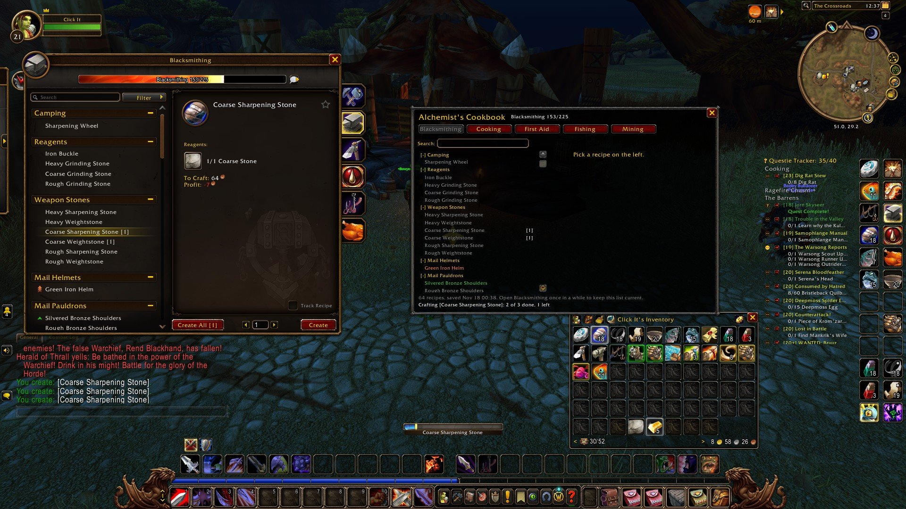
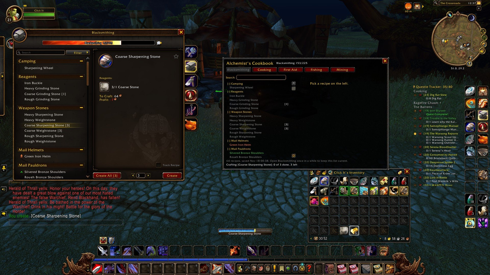
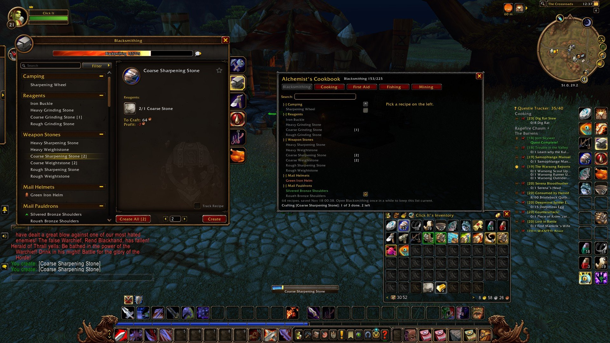
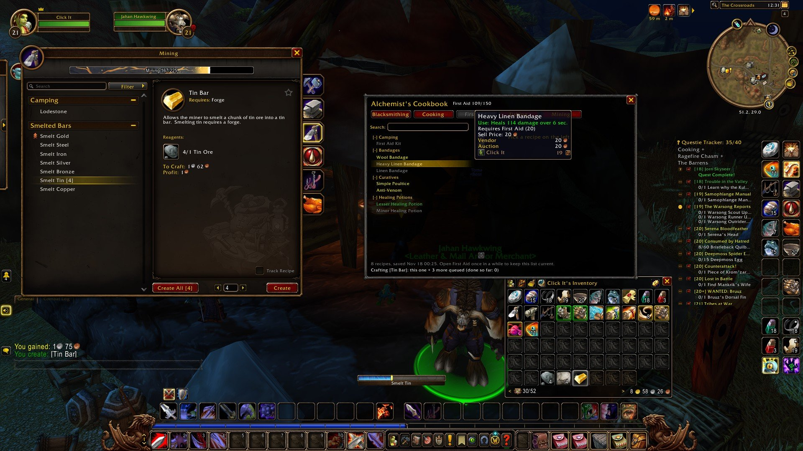
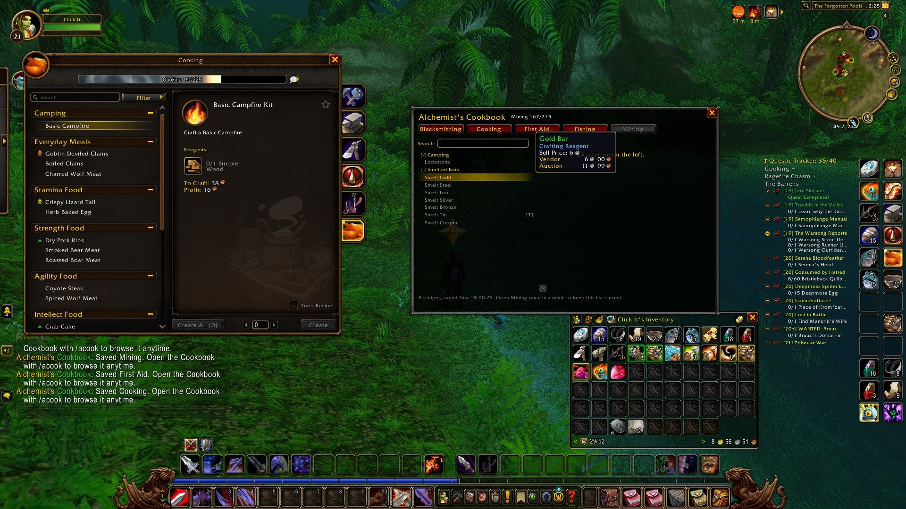
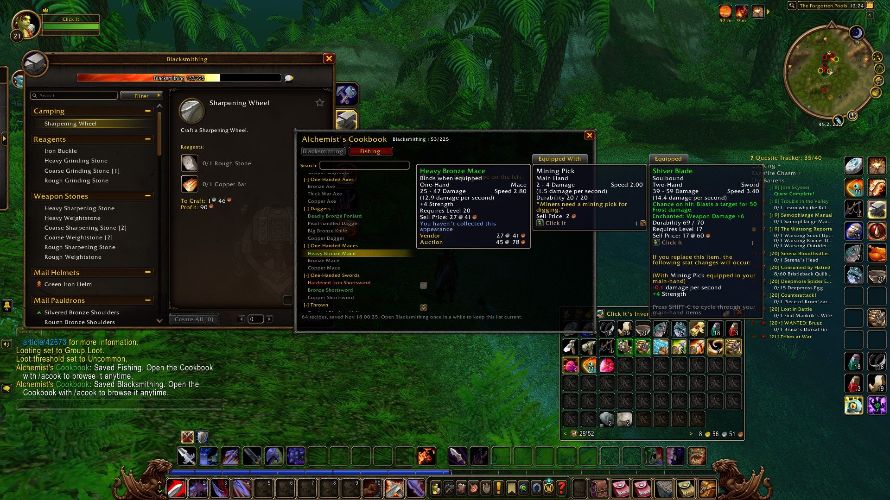
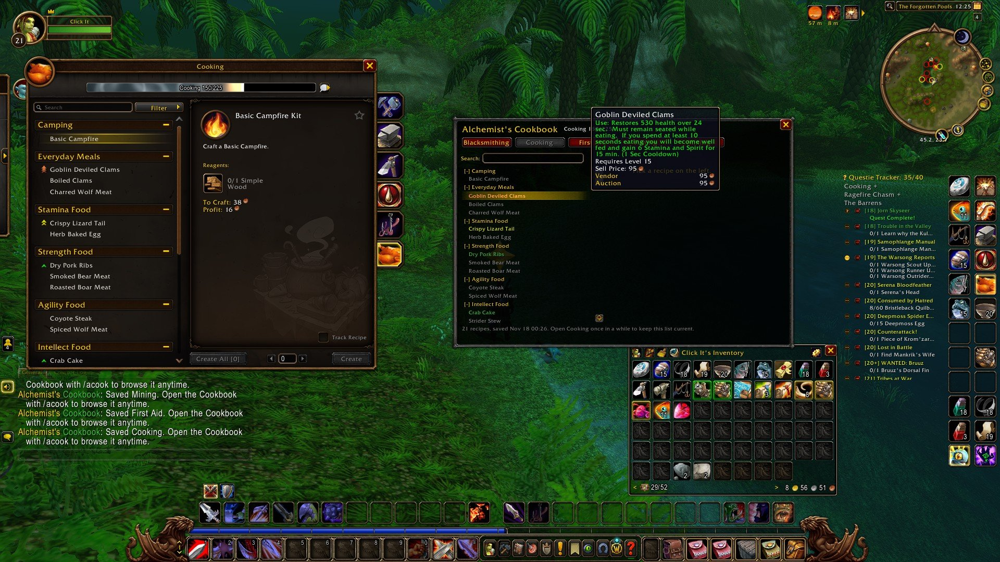
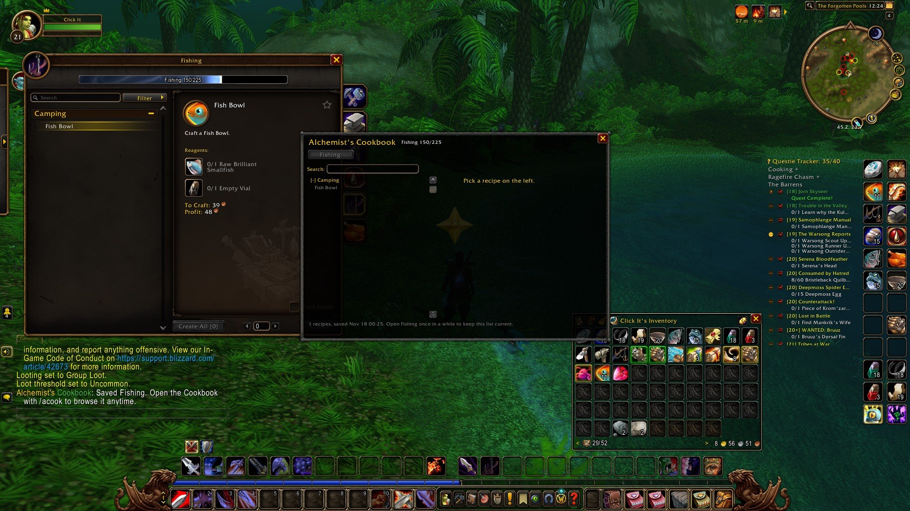
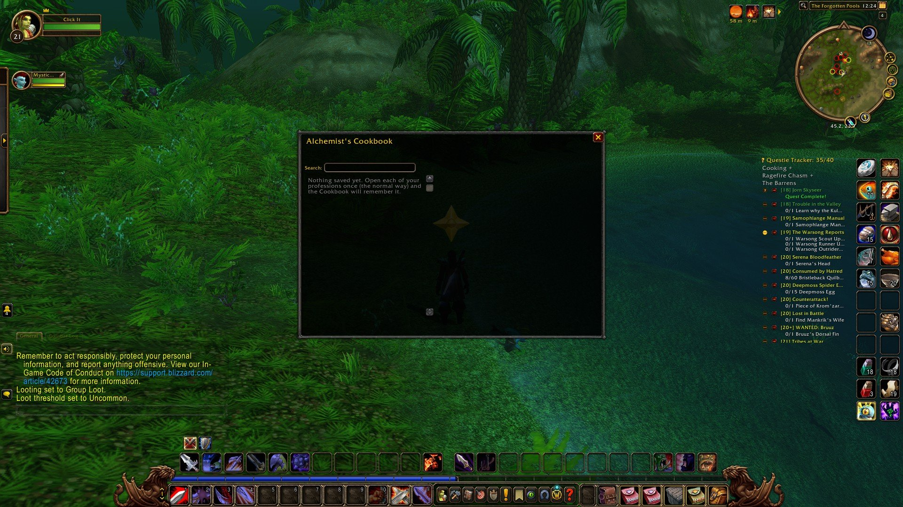

# Alchemist's Cookbook
*Browse every profession you know without stopping the craft you're in the middle of.*

You've queued up 200 Tin Bars and settled in. Halfway through, you want to check how many Coarse Sharpening Stones you could make, or what that Blacksmithing recipe needs. Open the Blacksmithing window and your smelting stops cold, because the game only lets one profession window be open at a time.

Alchemist's Cookbook fixes that. Every time you open a profession, it quietly saves your recipes. After that you can browse any of them in the Cookbook window while your repeat craft keeps going. Nothing gets cancelled until you jump or stop it yourself.

## Features
- One tab for each profession you've opened, all in one movable window
- Search by recipe name or reagent (type "tin" to find everything that uses it)
- How many of each recipe you can make right now, shown next to its name
- Reagent counts as "have / need", colored green, yellow (counting your bank) or red
- Item tooltips on hover, plus a live line showing what you're crafting and how many are left (for example "Crafting [Tin Bar]: 2 of 5 done, 3 left")
- Minimap button, keybind, `/acook` or `/cookbook`, and a settings page under Options > AddOns

## Getting started
1. Install it and restart the game.
2. Open each of your professions once the normal way, so the Cookbook can save it.
3. Start a long craft, open the Cookbook, and browse to your heart's content.

**Grows with you:** every time you open a profession, the Cookbook re-saves it, so new recipes and skill-ups are picked up automatically. Perfect for low-level characters too. Start with a handful of recipes and the Cookbook fills in as you level.


## Safe by design
The Cookbook only reads. It never crafts, casts, or opens or closes a profession window, so it can't interrupt what you're making. It's built for WoW Forever, and it's free and MIT licensed.

*The name is a safe-for-work nod to a certain infamous cookbook from back in the day.* 😉

**Download:** the [GitHub releases page](https://github.com/xclickitx/AlchemistsCookbook/releases) (CurseForge link to follow once the project is approved).

## Screenshots

**Keep crafting while you browse.** Coarse Sharpening Stone x3 is running and the Cookbook is open on Blacksmithing. The live line counts each one as it finishes.







**Check another profession mid-craft.** Smelt Tin keeps going in the Mining window while the Cookbook shows First Aid, with an item tooltip on hover.



**All your professions in one window,** with craftable counts in `[ ]` and item tooltips.







**First run:** open a profession the normal way and the Cookbook saves it.





## Details

- **Saving:** each time you open a profession, the Cookbook saves its learned recipes for that character: skill rank, recipe names and difficulty colors, icons, how many each makes, reagents and counts, required tools (Forge, Anvil and so on), and item links. Linked professions (someone else's, from chat) are never saved. An empty or half-loaded list never replaces a good saved one.
- **Window:** a tab per saved profession, a search box (recipe or reagent names), gold headers you click to collapse or expand, and `[N]` next to each recipe for how many you can make from your bags right now. Click a recipe for what it makes, the tools it needs, and each reagent as "have X / need Y":
  - green: enough in your bags
  - yellow: enough if you count your bank (what the game remembers from your last bank visit)
  - red: not enough
- **Live crafting line** at the bottom while you repeat-craft, for example `Crafting [Tin Bar]: 2 of 5 done, 3 left`. It clears when the batch finishes, when you jump or move to cancel, or about 8 seconds after crafting stops on its own.
- **Opening it:** minimap button (left-click open/close, right-click or shift-click for settings, drag to move), a keybind under Esc > Options > Keybindings > AddOns > Alchemist's Cookbook, `/acook` or `/cookbook`, and Esc closes it. The window can be dragged and remembers where you put it.
- **Settings page** under Esc > Options > AddOns > Alchemist's Cookbook (`/acook options`): Open Cookbook button, show minimap button, window size (60 to 150%), reset window position, and a list of what's saved on this character.

Recipes are saved per character (`SavedVariablesPerCharacter: AlchemistsCookbookCharDB`); window and minimap settings are per account (`SavedVariables: AlchemistsCookbookDB`).

## Slash commands

Both slash commands do the same thing: `/acook` or `/cookbook`.

| Command | What it does |
| --- | --- |
| `/acook` | Open or close the Cookbook |
| `/acook help` | List the commands |
| `/acook <profession>` | Open on that profession; the start of the name is enough (`/acook black`, `/acook mining`) |
| `/acook list` | Professions saved on this character, with recipe counts and skill |
| `/acook options` | Settings page (also `config`, `settings`) |
| `/acook minimap` | Show or hide the minimap button |
| `/acook scale <60-150>` | Window size in percent (`/acook scale 90`) |
| `/acook reset` | Move the window back to the middle at 100% |
| `/acook forget <profession>` | Delete that saved list (open the profession again to re-save it) |

## Install

1. Download `AlchemistsCookbook-1.0.1.zip`.
2. Close World of Warcraft.
3. Extract the `AlchemistsCookbook` folder into your WoW Forever add-ons directory:

   `World of Warcraft\_forever_\Interface\AddOns`

   The result must look like:

   `World of Warcraft\_forever_\Interface\AddOns\AlchemistsCookbook\AlchemistsCookbook.toc`

   There should not be an extra nested folder (`.../AddOns/AlchemistsCookbook/AlchemistsCookbook/...`).

4. Start the game (a `/reload` will not find a brand-new add-on folder; fully restart once).
5. At character select, click AddOns and make sure **Alchemist's Cookbook** is ticked.
6. Open each of your professions once so the Cookbook can save it.

Once the project is on CurseForge, you will also be able to install and update it with the CurseForge app, with the Forever flavor selected.

## Compatibility

- **World of Warcraft: Forever**, client **1.60.1**, TOC Interface **16001**.
- Written against the client's own profession API, checked in the 1.60.1 game files: `C_TradeSkillUI` (`GetBaseProfessionInfo`, `GetChildProfessionInfo`, `GetRecipeInfo`, `GetRecipeSchematic`, `GetRecipeOutputItemData`, `GetRecipeRequirements`, `GetRemainingRecasts`) and `C_Item.GetItemCount` / `GetItemInfo`. Classic-era trade skill and craft functions are kept only as guarded fallbacks. The settings page uses the Settings API.
- Not tested on Retail, Classic Era, or other flavors, and not advertised for them.

## Safety

The Cookbook only reads. It never crafts, casts, or opens or closes a profession window, and it uses no secure templates, so it can't create a protected action or interrupt what you're making. The Cookbook window opens in combat too; only the settings page waits until combat ends.

## License

[MIT](LICENSE). Copyright (c) 2026 ClickIT.

## Development

The `test/` folder is a mock harness (Python 3 + [lupa](https://pypi.org/project/lupa/) with Lua 5.1). It is kept in this repository so changes can be checked without launching the game. It is not part of the player zip.

```
cd test
python run.py
python globals.py
```

`run.py` runs the suite three times: against the modern Settings API, a legacy InterfaceOptions fallback, and the classic-era trade skill / craft functions. All three should report `fails=0`. `globals.py` lists every global the add-on reads or writes.
